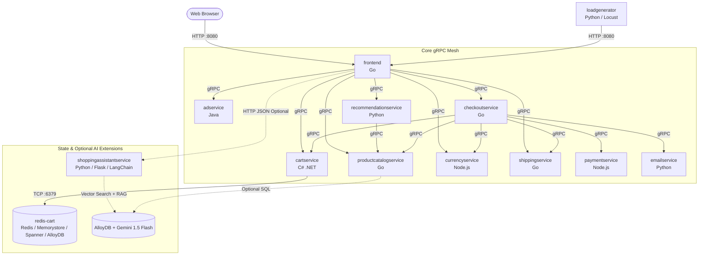
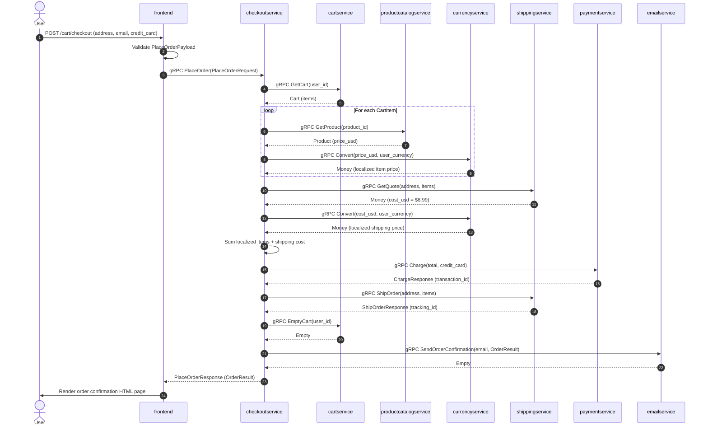

# Online Boutique (`microservices-demo`) — Architecture, Implementation & Developer Guide

**Online Boutique** is a cloud-first, polyglot microservices demonstration application maintained by Google Cloud. It implements a realistic web-based e-commerce store where users can browse vintage/hipster items, switch currencies, manage a shopping cart, receive product recommendations and contextual advertisements, and complete checkout orders.

This document explains the **system architecture**, **service-by-service implementation**, **core business logic**, **getting started workflows**, and **how to make changes and contribute**.

---

## Table of Contents

1. [Purpose & Design Philosophy](#1-purpose--design-philosophy)
2. [High-Level Architecture](#2-high-level-architecture)
3. [Inter-Service Communication & Protocol Buffers](#3-inter-service-communication--protocol-buffers)
4. [Microservices Implementation & Business Logic](#4-microservices-implementation--business-logic)
5. [Core End-to-End Workflows](#5-core-end-to-end-workflows)
6. [Cross-Cutting Concerns (Observability, Health, Security)](#6-cross-cutting-concerns-observability-health-security)
7. [Deployment & Configuration Architecture](#7-deployment--configuration-architecture)
8. [Getting Started](#8-getting-started)
9. [How to Make Changes & Develop Locally](#9-how-to-make-changes--develop-locally)
10. [How to Contribute](#10-how-to-contribute)

---

## 1. Purpose & Design Philosophy

### Primary Purpose
Online Boutique is built to showcase enterprise application modernization on Kubernetes and Google Cloud technologies—including **Google Kubernetes Engine (GKE)**, **Cloud Service Mesh (Istio)**, **gRPC**, **Cloud Operations (OpenTelemetry Tracing & Cloud Profiler)**, **Memorystore (Redis)**, **Cloud Spanner**, **AlloyDB**, and **Vertex AI / Gemini**—while remaining **100% compatible with any standard Kubernetes cluster** (local `kind`, `minikube`, EKS, AKS, etc.).

### Core Product Requirements ("The Three Pillars")
Every architectural decision and code change in this repository is governed by three strict product requirements (`docs/product-requirements.md`):
1. **Preserve the Golden User Journey for Kubernetes Beginners**: A user outside of Google must always be able to deploy the default configuration on a local `kind` cluster for free, with zero cloud provider dependencies.
2. **Preserve Demo Simplicity**: The primary user flow (browse $\rightarrow$ add to cart $\rightarrow$ pre-populated checkout form $\rightarrow$ place order) requires no signup, login, or real payment credentials.
3. **Preserve GKE Quickstart Simplicity**: Advanced cloud integrations (Spanner, AlloyDB, Istio, Gemini AI Assistant, Network Policies) are never forced into the default manifest; instead, they are packaged as modular, opt-in **Kustomize components** (`kustomize/components/`) or **Helm values** (`helm-chart/values.yaml`).

---

## 2. High-Level Architecture

Online Boutique consists of **11 core microservices** (plus 1 in-cluster Redis instance and 1 optional AI assistant microservice) written across **5 programming languages** (Go, C#/.NET, Node.js, Python, and Java).

### System Topology Diagram



### Service Matrix

| Service | Directory | Language / Runtime | Protocol & Default Port | Role & Responsibility |
| :--- | :--- | :--- | :--- | :--- |
| **`frontend`** | `src/frontend` | Go | HTTP (`8080`) | Serves the web UI, manages anonymous session cookies, and aggregates backend gRPC calls. |
| **`cartservice`** | `src/cartservice` | C# (.NET) | gRPC (`7070`) | Manages per-user shopping carts backed by Redis (default), Spanner, AlloyDB, or in-memory cache. |
| **`productcatalogservice`** | `src/productcatalogservice` | Go | gRPC (`3550`) | Serves product listings, product details, and keyword search from `products.json` or AlloyDB. |
| **`currencyservice`** | `src/currencyservice` | Node.js | gRPC (`7000`) | Lists supported currencies and converts `Money` amounts using European Central Bank (ECB) rates. Highest QPS service. |
| **`paymentservice`** | `src/paymentservice` | Node.js | gRPC (`50051`) | Validates credit card numbers/expiration (Visa/MasterCard) and returns mock transaction UUIDs. |
| **`shippingservice`** | `src/shippingservice` | Go | gRPC (`50051`) | Calculates shipping quotes in USD and generates mock shipment tracking IDs. |
| **`emailservice`** | `src/emailservice` | Python | gRPC (`8080`) | Renders HTML order confirmation emails via Jinja2 and logs dispatch (runs in dummy mode by default). |
| **`checkoutservice`** | `src/checkoutservice` | Go | gRPC (`5050`) | Orchestrates the checkout saga: reads cart, converts prices, quotes shipping, charges card, ships order, empties cart, and triggers email. |
| **`recommendationservice`** | `src/recommendationservice` | Python | gRPC (`8080`) | Queries `productcatalogservice`, filters out items already in the user's context, and returns up to 5 random product IDs. |
| **`adservice`** | `src/adservice` | Java (Gradle) | gRPC (`9555`) | Serves contextual text advertisements matched by product category keywords or random fallback. |
| **`loadgenerator`** | `src/loadgenerator` | Python (Locust) | Headless HTTP Client | Simulates concurrent user traffic hitting `frontend` with weighted browsing, cart, and checkout tasks. |
| **`shoppingassistantservice`** | `src/shoppingassistantservice` | Python (Flask) | HTTP (`8080`, Optional) | Multimodal RAG assistant using Gemini 1.5 Flash + AlloyDB `pgvector` to recommend catalog items from room photos. |

---

## 3. Inter-Service Communication & Protocol Buffers

All internal microservice-to-microservice communication (except the optional `shoppingassistantservice`) uses **gRPC over HTTP/2** defined in a single canonical contract: `protos/demo.proto` (package `hipstershop`).

### Why a Single Shared Proto File?
Keeping all service and message definitions in `protos/demo.proto` makes it easy to trace data contracts across all languages without complex multi-repo schema registries. Each service compiles `demo.proto` into its own language-specific stubs via a local `genproto.sh` script (or build-time plugin in C# and Java).

### Key Data Structures in `protos/demo.proto`
- **`Money` (`currency_code`, `units`, `nanos`)**:
  Floating-point numbers (`float`/`double`) are intentionally avoided for monetary representation to prevent rounding errors. Instead, amounts are split into integer `units` (whole currency units, e.g., dollars) and `nanos` ($10^{-9}$ units). For example, `$1.75` is represented as `units: 1, nanos: 750000000`.
- **`Cart` & `CartItem`**: Associates a `user_id` (the session UUID) with a repeated list of `{product_id, quantity}`.
- **`Product`**: Contains `id`, `name`, `description`, `picture`, `price_usd` (`Money`), and repeated `categories` strings.
- **`OrderResult`**: Returned upon checkout completion with `order_id`, `shipping_tracking_id`, `shipping_cost`, `shipping_address`, and itemized `OrderItem` entries.

---

## 4. Microservices Implementation & Business Logic

### 4.1 `frontend` (`src/frontend` — Go)
- **Routing & Server**: Uses `gorilla/mux` (`main.go`) exposing HTTP routes (`/`, `/product/{id}`, `/cart`, `/cart/empty`, `/cart/checkout`, `/setCurrency`, `/logout`, `/assistant`, `/bot`, `/_healthz`).
- **Middleware Chain (`middleware.go`)**:
  Every incoming HTTP request passes through:
  1. `otelhttp.NewHandler`: Extracts/starts OpenTelemetry HTTP spans.
  2. `ensureSessionID`: Reads the `shop_session-id` cookie. If missing, generates a v4 UUID (or uses fixed UUID `12345678-1234-1234-1234-123456789123` if `ENABLE_SINGLE_SHARED_SESSION=true`) and sets a 48-hour cookie.
  3. `logHandler`: Assigns a unique `http.req.id` UUID, injects structured JSON `logrus` fields into `r.Context()`, and logs request duration, status code, and byte size on completion.
- **Currency Handling & Exact Arithmetic (`money/money.go`)**:
  The user's active currency is stored in the `shop_currency` cookie (default `USD`, whitelisted to `USD`, `EUR`, `CAD`, `JPY`, `GBP`, `TRY`). The `money` package implements exact fixed-point addition (`Sum`) and multiplication (`MultiplySlow`) on `pb.Money` structs by carrying nano overflows ($10^9$ nanos = 1 unit).
- **Input Validation (`validator/validator.go`)**:
  Uses `go-playground/validator/v10` to validate form payloads (`AddToCartPayload` ensures `quantity` is between 1 and 10; `PlaceOrderPayload` validates email format, zip code, credit card fields).
- **Cloud Provider Auto-Detection (`handlers.go`)**:
  On the home page, `frontend` checks `ENV_PLATFORM` and performs a DNS lookup for `metadata.google.internal.` to automatically display a banner badge indicating whether it is running on Google Cloud, AWS, Azure, Alibaba, On-Premises, or Local.

### 4.2 `checkoutservice` (`src/checkoutservice` — Go)
Acts as a stateless **Saga Orchestrator** for the `PlaceOrder` RPC (`main.go`):
1. **Generate Order ID**: Creates a new UUID for the order.
2. **Prepare Order & Quote (`prepareOrderItemsAndShippingQuoteFromCart`)**:
   - Calls `CartService.GetCart` to fetch the user's `CartItem` list.
   - For each cart item, calls `ProductCatalogService.GetProduct` to get its base `price_usd`, then calls `CurrencyService.Convert` to convert the item price into the user's selected currency.
   - Calls `ShippingService.GetQuote` with the cart items and address to get the shipping cost in USD, then converts that quote into the user's currency via `CurrencyService.Convert`.
3. **Calculate Total**: Sums the localized shipping cost and `(item_cost * quantity)` for all items using exact `money.Sum` arithmetic.
4. **Charge Payment**: Calls `PaymentService.Charge` with the total `Money` amount and `CreditCardInfo`. If payment validation fails, `PlaceOrder` aborts immediately with an error before shipping or emptying the cart.
5. **Ship Order**: Calls `ShippingService.ShipOrder` to obtain a `shipping_tracking_id`.
6. **Empty Cart**: Calls `CartService.EmptyCart` to clear the user's cart.
7. **Send Confirmation Email**: Calls `EmailService.SendOrderConfirmation` with the `OrderResult`. If the email call fails, it logs a warning rather than failing the completed order.

### 4.3 `cartservice` (`src/cartservice` — C# / .NET)
- **Dependency Injection Strategy (`Startup.cs`)**:
  Uses the `ICartStore` interface (`AddItemAsync`, `EmptyCartAsync`, `GetCartAsync`, `Ping`) and selects the backing implementation at startup based on environment variables:
  1. `REDIS_ADDR` set $\rightarrow$ registers `RedisCartStore` with `StackExchangeRedisCache`.
  2. `SPANNER_PROJECT` or `SPANNER_CONNECTION_STRING` set $\rightarrow$ registers `SpannerCartStore`.
  3. `ALLOYDB_PRIMARY_IP` set $\rightarrow$ registers `AlloyDBCartStore` (fetches database password from Google Cloud Secret Manager).
  4. None set $\rightarrow$ falls back to `AddDistributedMemoryCache()` with `RedisCartStore`.
- **Serialization & Logic (`RedisCartStore.cs`)**:
  Serializes the `Hipstershop.Cart` Protobuf message directly to a raw byte array (`cart.ToByteArray()`) stored under the `userId` key in Redis. When `AddItemAsync` is called, it deserializes the existing `Cart` from Redis, checks if `productId` already exists in `cart.Items` (incrementing `Quantity` if found, or appending a new `CartItem` if not), and writes the byte array back.

### 4.4 `productcatalogservice` (`src/productcatalogservice` — Go)
- **Data Loading (`catalog_loader.go`)**:
  By default, reads `products.json` from disk and unmarshals it into a `pb.ListProductsResponse` struct in memory protected by `catalogMutex`. If `ALLOYDB_CLUSTER_NAME` is set, it connects to AlloyDB via `alloydbconn.NewDialer` and `pgxpool` (retrieving credentials from Secret Manager) and queries the catalog table.
- **Dynamic Reload Signal & Chaos Latency (`server.go`, `product_catalog.go`)**:
  - Listens for Unix signals: sending `SIGUSR1` enables catalog reloading on every request (intentionally introducing a file-read/parsing performance bottleneck useful for profiling demos), while `SIGUSR2` disables it and caches the catalog in memory.
  - Supports fault/latency injection via the `EXTRA_LATENCY` environment variable (e.g., `EXTRA_LATENCY=500ms`), sleeping before every `ListProducts`, `GetProduct`, and `SearchProducts` RPC.
- **Search Logic**: `SearchProducts` performs a case-insensitive substring match (`strings.Contains`) of the query against each product's `Name` and `Description`.

### 4.5 `currencyservice` (`src/currencyservice` — Node.js)
- **Why it is the highest QPS service**: Every homepage load converts the price of all 9 catalog products (`9` RPCs) plus `GetSupportedCurrencies` (`1` RPC). Every cart view and checkout also converts each line item and shipping quote.
- **Conversion Logic (`server.js`)**:
  Reads exchange rates relative to `EUR` from `data/currency_conversion.json`. When converting `from` currency $A$ `to_code` currency $B$:
  1. Divides `from.units` and `from.nanos` by `data[A]` to get the intermediate value in Euros (`EUR`).
  2. Uses the `_carry(amount)` helper to redistribute fractional units into `nanos` ($10^9$) and carry whole integers back into `units`.
  3. Multiplies the Euro `units` and `nanos` by `data[B]`, runs `_carry()` again, floors both values to integers, and returns the resulting `Money` message.

### 4.6 `paymentservice` (`src/paymentservice` — Node.js)
- **Validation Logic (`charge.js`)**:
  1. Validates the credit card number using `simple-card-validator` (Luhn check and card network detection). Throws `InvalidCreditCard` if invalid.
  2. Enforces card network policy: only `visa` and `mastercard` are accepted; other networks (such as AMEX or Diners Club) throw `UnacceptedCreditCard`.
  3. Checks that `(expiration_year * 12 + expiration_month) >= (current_year * 12 + current_month)`; otherwise throws `ExpiredCreditCard`.
  4. Logs the last 4 digits and amount, and returns a newly generated `uuidv4()` as `transaction_id`.

### 4.7 `shippingservice` (`src/shippingservice` — Go)
- **Quote Calculation (`quote.go`)**:
  Sums the total item count across the cart. If `count == 0`, returns `$0.00`. Otherwise, returns a flat shipping rate of **`$8.99` USD** (`units: 8, nanos: 990000000`).
- **Tracking ID Generation (`tracker.go`)**:
  `CreateTrackingId(salt)` formats a realistic tracking number matching `XX-<len><3digits>-<len/2><7digits>` (e.g., `AB-28491-148392014`) seeded by the length of the formatted street/city/state string and random uppercase letters/digits.

### 4.8 `recommendationservice` (`src/recommendationservice` — Python)
- **Algorithm (`recommendation_server.py`)**:
  1. Calls `ProductCatalogService.ListProducts` over gRPC to get all available product IDs.
  2. Computes the set difference `set(all_product_ids) - set(request.product_ids)` to exclude products the user is currently viewing or already holds in their cart.
  3. Uses `random.sample` to pick up to `max_responses = 5` product IDs (note: `frontend` further slices this list to `4` items to fit the UI grid).

### 4.9 `adservice` (`src/adservice` — Java)
- **Contextual Lookup (`AdService.java`)**:
  Maintains an in-memory Guava `ImmutableListMultimap<String, Ad>` mapping category keywords (`clothing`, `accessories`, `footwear`, `hair`, `decor`, `kitchen`) to promotional `Ad` objects (redirect URL + discount text).
- When `GetAds` is called with `context_keys` (e.g., product categories on the product detail page), it collects all ads matching those categories. If `context_keys` is empty (e.g., on the homepage) or no category matches, it falls back to `getRandomAds()`, picking `MAX_ADS_TO_SERVE = 2` ads at random. `frontend` then randomly selects one `Ad` from the returned list to render in the page footer.

### 4.10 `emailservice` (`src/emailservice` — Python)
- **Template Rendering & Dummy Mode (`email_server.py`)**:
  Loads `templates/confirmation.html` using `Jinja2` with HTML autoescaping enabled. By default, the server starts `DummyEmailService`, which logs the recipient email address and returns `Empty` without requiring external SMTP/Cloud Mail credentials. An `EmailService` class is also scaffolded showing how `confirmation.html` is rendered with the `OrderResult` payload.

### 4.11 `loadgenerator` (`src/loadgenerator` — Python / Locust)
- **Realistic Traffic Simulation (`locustfile.py`)**:
  Uses `FastHttpUser` from `Locust` and `Faker` to continuously simulate synthetic shoppers waiting between `1` and `10` seconds between actions.
- **Task Weights**:
  - `browseProduct`: weight `10`
  - `viewCart`: weight `3`
  - `setCurrency`: weight `2`
  - `addToCart`: weight `2`
  - `index` (homepage): weight `1`
  - `checkout` (adds item to cart + submits checkout with fake Visa card): weight `1`

### 4.12 `shoppingassistantservice` (`src/shoppingassistantservice` — Python / Flask, Optional)
- **Multimodal RAG Architecture (`shoppingassistantservice.py`)**:
  1. **Vision Step**: Sends the user-uploaded room image to **Gemini 1.5 Flash** (`ChatGoogleGenerativeAI(model="gemini-1.5-flash")`) prompting it to act as an interior designer and describe the room's style in detail.
  2. **Vector Similarity Search**: Combines the user's text prompt with Gemini's room description and performs a vector similarity search against `AlloyDBVectorStore` using `GoogleGenerativeAIEmbeddings(model="models/embedding-001")`.
  3. **Augmented Generation Step**: Prompts Gemini 1.5 Flash with the room description, retrieved catalog documents, and user request to generate a natural-language recommendation along with the top 3 matching product IDs (`[<id1>], [<id2>], [<id3>]`), which the frontend parses and renders with product cards.

---

## 5. Core End-to-End Workflows

### Checkout Sequence Diagram



---

## 6. Cross-Cutting Concerns (Observability, Health, Security)

1. **Distributed Tracing (OpenTelemetry)**:
   - Controlled via `ENABLE_TRACING=1` and `COLLECTOR_SERVICE_ADDR`.
   - Services instrument both incoming and outgoing gRPC/HTTP calls using OpenTelemetry SDKs (`otelgrpc` and `otelhttp` in Go, `@opentelemetry/instrumentation-grpc` in Node.js, `GrpcInstrumentorServer`/`Client` in Python) and export spans via OTLP/gRPC to an OpenTelemetry Collector.
2. **Continuous Profiling (Cloud Profiler)**:
   - Controlled via `ENABLE_PROFILER=1` / `DISABLE_PROFILER`.
   - Go and Node.js services initialize the Google Cloud Profiler agent with retry backoff to capture CPU and heap profiles in production.
3. **Health Checks**:
   - All gRPC backends implement the standard `grpc.health.v1.Health` (`Check`) service returning `SERVING`.
   - Kubernetes deployments use native `grpc` readiness and liveness probes (and `httpGet` on `/_healthz` for `frontend`).
4. **Security & Hardening**:
   - Container images use multi-stage builds, non-root execution users, and slim/distroless base images.
   - Pod manifests configure `securityContext` (`allowPrivilegeEscalation: false`, `capabilities.drop: [ALL]`, `privileged: false`, `readOnlyRootFilesystem: true` where supported) and explicit CPU/Memory `requests` and `limits`.

---

## 7. Deployment & Configuration Architecture

The repository provides multiple ways to deploy the system depending on your environment and use case:

| Directory | Purpose | When to Use |
| :--- | :--- | :--- |
| **`release/`** | Pre-rendered, version-pinned YAML (`kubernetes-manifests.yaml`, `istio-manifests.yaml`) pointing to official release images in Artifact Registry. | Quickest 1-command deployment (`kubectl apply -f ./release/kubernetes-manifests.yaml`) without building code. |
| **`kubernetes-manifests/`** | Raw per-service manifests used by **Skaffold** during local development (`skaffold.yaml`). | Building and deploying from source with `skaffold run` or `skaffold dev`. |
| **`kustomize/`** | Base manifests (`kustomize/base/`) + composable feature overlays (`kustomize/components/`). | Deploying variations (Cymbal branding, Cloud Operations, Spanner, AlloyDB, Memorystore, Istio, Network Policies, Shopping Assistant). |
| **`helm-chart/`** | Parameterized Helm chart (`Chart.yaml`, `values.yaml`, `templates/`). | Installing via Helm (`helm upgrade --install`) with customizable values. |
| **`terraform/`** | Infrastructure-as-Code scripts (`main.tf`, `memorystore.tf`). | Provisioning a GKE cluster, VPC/network resources, optional Memorystore, and deploying the app end-to-end. |

---

## 8. Getting Started

### Option A: Quickest Deployment (Pre-built Release Images on Any Cluster)
If you already have a running Kubernetes cluster (`kind`, `minikube`, Docker Desktop, or GKE) and only want to run the app without building images locally:

```bash
kubectl apply -f ./release/kubernetes-manifests.yaml
kubectl get pods -w
```

Once all pods are `Running`, access the web UI:
- **Local cluster (`kind` / `minikube` / Docker Desktop)**:
  ```bash
  kubectl port-forward deployment/frontend 8080:8080
  ```
  Open `http://localhost:8080` in your browser.
- **Cloud cluster (GKE / EKS / AKS)** with LoadBalancer support:
  ```bash
  kubectl get service frontend-external
  ```
  Open `http://<EXTERNAL-IP>` in your browser.

---

### Option B: Local Development Cluster (Build from Source with Skaffold)

#### 1. Prerequisites
- [Docker](https://docs.docker.com/get-docker/)
- [kubectl](https://kubernetes.io/docs/tasks/tools/)
- [Skaffold v2.0.2+](https://skaffold.dev/docs/install/)
- A local Kubernetes cluster (`minikube`, `kind`, or Docker Desktop) provisioned with at least **4 CPUs**, **4–6 GiB RAM**, and **32 GB disk**.

#### 2. Start a Local Cluster
```bash
# Using Minikube:
minikube start --cpus=4 --memory 4096 --disk-size 32g

# OR using Kind:
kind create cluster
```

#### 3. Build and Deploy with Skaffold
From the repository root:
```bash
# Build all container images locally and deploy to your cluster:
skaffold run
```
*(Note: The initial build compiles 11 services across 5 languages and may take 15–20 minutes on the first run; subsequent runs use Docker BuildKit caching.)*

#### 4. Forward Port & Browse
```bash
kubectl port-forward deployment/frontend 8080:8080
```
Visit `http://localhost:8080`. To tear down all deployed resources when finished:
```bash
skaffold delete
```

---

### Option C: Deploy on Google Kubernetes Engine (GKE) with Skaffold
1. **Create a GKE Autopilot cluster & Artifact Registry**:
   ```bash
   export PROJECT_ID=<your-gcp-project-id>
   export REGION=us-central1

   gcloud services enable container.googleapis.com artifactregistry.googleapis.com --project=${PROJECT_ID}
   gcloud container clusters create-auto online-boutique --project=${PROJECT_ID} --region=${REGION}
   gcloud artifacts repositories create microservices-demo --repository-format=docker --location=us --project=${PROJECT_ID}
   gcloud auth configure-docker us-docker.pkg.dev -q
   ```
2. **Build, push, and deploy**:
   ```bash
   skaffold run --default-repo=us-docker.pkg.dev/${PROJECT_ID}/microservices-demo
   ```
   *(Tip: If running from environments with limited disk space like Cloud Shell, offload builds to Cloud Build using `-p gcb`: `skaffold run -p gcb --default-repo=us-docker.pkg.dev/${PROJECT_ID}/microservices-demo`.)*

---

### Option D: Deploy Custom Variations with Kustomize
You can compose optional features located in `kustomize/components/`:
```bash
cd kustomize/

# Example: Enable Cymbal Shops branding and Google Cloud Operations (Tracing/Monitoring/Profiler)
kustomize edit add component components/cymbal-branding
kustomize edit add component components/google-cloud-operations

# Preview generated manifests:
kubectl kustomize .

# Apply to cluster:
kubectl apply -k .
```

Available Kustomize components in `kustomize/components/` include:
- `cymbal-branding` — Switches UI branding to "Cymbal Shops".
- `google-cloud-operations` — Deploys OpenTelemetry collector & enables tracing/profiling/stats.
- `memorystore`, `spanner`, `alloydb` — Swaps the backing database for `cartservice` (and `productcatalogservice` for AlloyDB).
- `network-policies` — Applies strict zero-trust Kubernetes `NetworkPolicy` rules between pods.
- `service-mesh-istio` — Configures Istio `VirtualService`, `Gateway`, `ServiceEntry`, and `Sidecar` resources.
- `shopping-assistant` — Deploys the Gemini + AlloyDB AI shopping assistant.
- `single-shared-session`, `non-public-frontend`, `custom-base-url`.

---

## 9. How to Make Changes & Develop Locally

### 9.1 Live Code Reloading with `skaffold dev`
When actively editing microservice code, use:
```bash
skaffold dev --port-forward
```
`skaffold dev` watches your local `src/` files, automatically rebuilds only the modified microservice image, redeploys its Kubernetes Deployment, streams container logs to your terminal, and port-forwards services automatically.

### 9.2 Debugging Services (`skaffold debug`)
`skaffold.yaml` includes a `debug` profile (automatically activated when running `skaffold debug`) that swaps `cartservice`'s `Dockerfile` for `Dockerfile.debug` and configures runtime debugging ports so you can attach an IDE debugger (such as VS Code or Cloud Code) directly to pods running in the cluster.

### 9.3 Modifying a Microservice
1. Locate the service under `src/<servicename>/`.
2. Make your code changes:
   - **Go services** (`frontend`, `checkoutservice`, `productcatalogservice`, `shippingservice`): Run unit tests locally inside the service directory via `go test ./...`.
   - **C# service** (`cartservice`): Run unit tests in `src/cartservice/tests` via `dotnet test`.
   - **Node.js services** (`currencyservice`, `paymentservice`): Update `server.js` or `charge.js`. If updating dependencies, update `package.json` and `package-lock.json`.
   - **Python services** (`recommendationservice`, `emailservice`, `loadgenerator`, `shoppingassistantservice`): Dependencies are pinned using `pip-compile` from `requirements.in` $\rightarrow$ `requirements.txt`.
   - **Java service** (`adservice`): Built with Gradle (`./gradlew installDist`).
3. Test your changes in-cluster with `skaffold run` or `skaffold dev`.

### 9.4 Changing the gRPC Contract (`protos/demo.proto`)
If you add or modify an RPC or message in `protos/demo.proto`:
1. Edit `protos/demo.proto`.
2. Regenerate the language-specific gRPC stubs for affected services:
   - **`frontend`**, **`checkoutservice`**, **`productcatalogservice`**, **`shippingservice`**: Run `./genproto.sh` inside each Go service's directory (requires `protoc` and `protoc-gen-go` / `protoc-gen-go-grpc`), which updates `genproto/demo.pb.go`.
   - **`recommendationservice`** & **`emailservice`**: Run `./genproto.sh` inside the Python service's directory (uses `grpc_tools.protoc` to regenerate `demo_pb2.py` and `demo_pb2_grpc.py`).
   - **`currencyservice`** & **`paymentservice`**: Run `./genproto.sh` (or copy the updated `demo.proto` into the service's `proto/` directory, as Node.js loads `.proto` files dynamically at runtime via `@grpc/proto-loader`).
   - **`adservice`**: Copy `protos/demo.proto` to `src/adservice/src/main/proto/demo.proto` (Gradle compiles it automatically during build).
   - **`cartservice`**: Uses `Grpc.Tools` in `cartservice.csproj` which compiles `protos/demo.proto` during `dotnet build`.

### 9.5 Adding a New Microservice
As documented in `docs/adding-new-microservice.md`, new microservices should generally be **opt-in** to preserve the core architecture. To add one:
1. **Create Source Directory**: Create `src/<new-service>/` containing your application code, `README.md`, dependency manifests, and a multi-stage `Dockerfile`.
2. **Create Kustomize Component**: Create `kustomize/components/<new-service>/` with a `kustomization.yaml` (`kind: Component`), Kubernetes `Deployment`, and `Service` manifests (see `kustomize/components/shopping-assistant/` for a reference example).
3. **Register in Kustomize (if applicable)**: Reference or document the component in `kustomize/`.
4. **Update `skaffold.yaml`**: Add an entry under `build.artifacts` with `image: <new-service>` and `context: src/<new-service>`.
5. **Update `helm-chart/`**: Add optional template files in `helm-chart/templates/` and configuration toggles in `helm-chart/values.yaml`.
6. **Update Documentation**: Document the service in `README.md` and `docs/`.

---

## 10. How to Contribute

### Contribution Checklist & Guidelines (`.github/CONTRIBUTING.md`)
1. **Sign the Google CLA**: Before your PR can be merged, sign the Contributor License Agreement at [cla.developers.google.com](https://cla.developers.google.com/).
2. **Check Alignment with Project Purpose & Requirements**:
   - Review `docs/purpose.md` and `docs/product-requirements.md`.
   - Does the default configuration still work out-of-the-box on a local `kind` cluster without cloud credentials?
   - Does the GKE quickstart remain simple?
   - If your feature adds cloud-specific resources or extra complexity, implement it as an **opt-in Kustomize component** under `kustomize/components/`.
3. **Small vs. Large Changes**:
   - **Small changes** (bug fixes, dependency updates, documentation fixes): Open a Pull Request directly.
   - **Large changes** (new components, architectural changes): Open a GitHub Issue first to discuss the design with maintainers before investing implementation effort.

### Keeping Manifests in Sync
If you modify base Kubernetes manifests in `kubernetes-manifests/`:
- Note that `kustomize/base/` and `helm-chart/templates/` mirror the core service deployments. Ensure your changes are consistent across `kubernetes-manifests/`, `kustomize/`, and `helm-chart/` if they apply to the default deployment.

### Automated CI/CD Validation (`.github/workflows/`)
When you open a Pull Request, GitHub Actions runs the following checks:
- **Unit Tests (`ci-pr.yaml`)**: Runs Go unit tests across `frontend`, `checkoutservice`, `productcatalogservice`, and `shippingservice`.
- **Kustomize Build CI (`kustomize-build-ci.yaml`)**: Validates that `kustomize/base` and all `kustomize/components/*` combinations render valid Kubernetes YAML without errors (`kustomize/tests/`).
- **Helm Chart CI (`helm-chart-ci.yaml`)**: Lints and validates `helm-chart/` rendering across various `values.yaml` overrides.
- **Kubevious Manifests CI (`kubevious-manifests-ci.yaml`)**: Checks Kubernetes manifests for misconfigurations and anti-patterns.
- **Terraform Validate CI (`terraform-validate-ci.yaml`)**: Runs `terraform validate` and formatting checks on `terraform/`.
- **Staging Deploy Tests (`ci-pr.yaml` / `deploy-pr.yaml`)**: For repo-branched PRs, creates an ephemeral namespace in the CI GKE cluster, runs `skaffold run`, verifies all pods reach `Ready`, and posts the staging LoadBalancer IP to the PR.
