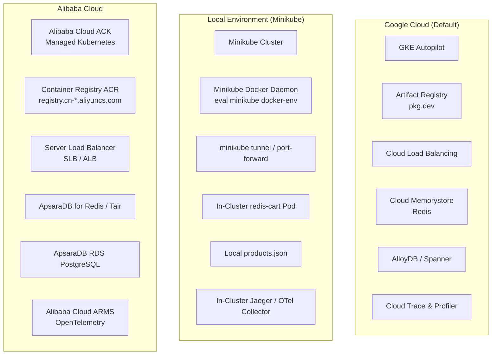

# Migrating from Google Kubernetes Engine (GKE) to Minikube (Local) and Alibaba Cloud ACK (Cloud)

This guide explains how Online Boutique interacts with its underlying Kubernetes platform and provides a complete walkthrough for replacing **Google Kubernetes Engine (GKE)** and **Google Cloud services** with:
1. **Minikube** for a 100% local development and testing environment.
2. **Alibaba Cloud Container Service for Kubernetes (ACK)**—along with Alibaba Cloud Container Registry (ACR), Tair/Redis, and ApsaraDB RDS PostgreSQL—for a production cloud environment.

---

## Table of Contents

1. [Understanding GCP-Specific Coupling vs. Cloud-Agnostic Core](#1-understanding-gcp-specific-coupling-vs-cloud-agnostic-core)
2. [Cloud Provider Mapping Matrix (GCP vs. Minikube vs. Alibaba Cloud)](#2-cloud-provider-mapping-matrix-gcp-vs-minikube-vs-alibaba-cloud)
3. [Part 1: Local Environment with Minikube](#3-part-1-local-environment-with-minikube)
4. [Part 2: Cloud Environment with Alibaba Cloud (ACK)](#4-part-2-cloud-environment-with-alibaba-cloud-ack)
5. [Part 3: Replacing Terraform Infrastructure-as-Code (`terraform/` -> Alibaba Cloud)](#5-part-3-replacing-terraform-infrastructure-as-code-terraform---alibaba-cloud)
6. [Part 4: Adapting Managed Databases & Observability](#6-part-4-adapting-managed-databases--observability)

---

## 1. Understanding GCP-Specific Coupling vs. Cloud-Agnostic Core

Online Boutique is architected so that its **base Kubernetes manifests (`kubernetes-manifests/`, `kustomize/base/`, `helm-chart/`) use standard Kubernetes APIs** (`Deployment`, `Service`, `ServiceAccount`). However, several layers in the repository default to Google Cloud:

1. **Container Image Registry**:
   - Pre-built manifests (`release/kubernetes-manifests.yaml` and `kustomize/base/`) pull images from Google Artifact Registry (`us-central1-docker.pkg.dev/online-boutique-ci/microservices-demo/*`).
   - Note: In regions with restricted access to `pkg.dev` (such as mainland China on Alibaba Cloud), pods will get stuck in `ImagePullBackOff` unless images are mirrored or built into **Alibaba Cloud Container Registry (ACR)**.
2. **Platform Banner & Metadata Detection (`src/frontend/handlers.go`)**:
   - The `frontend` service checks the `ENV_PLATFORM` environment variable (`local`, `gcp`, `aws`, `azure`, `onprem`, `alibaba`) and renders a provider-specific CSS banner at the top of the store.
   - If `ENV_PLATFORM` is not running on GKE (where `metadata.google.internal.` resolves), setting `ENV_PLATFORM=local` (for Minikube) or `ENV_PLATFORM=alibaba` (for Alibaba Cloud ACK) displays the **Alibaba Cloud** or **local** ribbon in the UI.
3. **Cloud Profiler (`DISABLE_PROFILER` / `ENABLE_PROFILER`)**:
   - Several services (`productcatalogservice`, `shippingservice`, `currencyservice`, `paymentservice`, `recommendationservice`, `emailservice`) attempt to initialize the Google Cloud Profiler agent (`cloud.google.com/go/profiler` or `@google-cloud/profiler`) unless `DISABLE_PROFILER=1` is set (`frontend` and `checkoutservice` use `ENABLE_PROFILER=0` by default).
   - While they gracefully give up after 3 retries (~60 seconds) outside GCP, setting `DISABLE_PROFILER: "1"` in non-GKE environments eliminates startup warnings and unnecessary metadata server timeouts.
4. **Terraform Provisioning (`terraform/`)**:
   - The `terraform/` directory uses the `google` provider (`google_container_cluster`, `google_redis_instance`). To provision infrastructure on Alibaba Cloud, this is replaced with the `alicloud` provider (`alicloud_cs_managed_kubernetes`, `alicloud_kvstore_instance`).

---

## 2. Cloud Provider Mapping Matrix (GCP vs. Minikube vs. Alibaba Cloud)



| Capability | Google Cloud (Original) | Minikube (Local) | Alibaba Cloud (Cloud) |
| :--- | :--- | :--- | :--- |
| **Kubernetes Engine** | GKE (`google_container_cluster`) | Minikube (`minikube start`) | Alibaba Cloud ACK (`alicloud_cs_managed_kubernetes`) |
| **Container Registry** | Artifact Registry (`*.pkg.dev`) | Minikube in-cluster Docker daemon | Alibaba Cloud ACR (`registry.<region>.aliyuncs.com`) |
| **External Load Balancer** | GCP Network Load Balancer | `minikube tunnel` or `kubectl port-forward` | Alibaba Cloud SLB (CLB / ALB) |
| **Cart Cache (`cartservice`)** | Cloud Memorystore (Redis) | In-cluster `redis-cart` pod (`redis:alpine`) | In-cluster `redis-cart` or **ApsaraDB for Redis (Tair)** |
| **Catalog DB (`productcatalog`)** | Local `products.json` or AlloyDB | Local `products.json` | Local `products.json` or **ApsaraDB RDS for PostgreSQL** |
| **UI Platform Flag (`ENV_PLATFORM`)** | `gcp` | `local` | `alibaba` |
| **Observability (OTLP)** | Google Cloud Trace / Operations | Local Jaeger / Zipkin via OTel Collector | **Alibaba Cloud ARMS** / Managed Prometheus |

---

## 3. Part 1: Local Environment with Minikube

### 3.1 Prerequisites
- [Docker](https://docs.docker.com/get-docker/) (or QEMU/KVM/Hyper-V driver)
- [Minikube](https://minikube.sigs.k8s.io/docs/start/)
- [kubectl](https://kubernetes.io/docs/tasks/tools/)
- [Skaffold v2.0.2+](https://skaffold.dev/docs/install/) (if building from source)

### 3.2 Start and Configure Minikube
Online Boutique runs 11 microservices + 1 Redis pod. Allocate at least **4 CPUs**, **4–6 GiB RAM**, and **32 GB disk**:

```bash
minikube start --cpus=4 --memory=6144 --disk-size=32g --driver=docker
```

Verify your `kubectl` context is pointing to `minikube`:
```bash
kubectl config current-context
# Output: minikube
kubectl get nodes
```

### 3.3 Option A: Deploy Pre-Built Images on Minikube
If your machine can reach `us-central1-docker.pkg.dev`, you can deploy immediately without building code:

```bash
kubectl apply -f ./release/kubernetes-manifests.yaml
kubectl get pods -w
```

### 3.4 Option B: Build from Source Locally into Minikube's Docker Daemon
When building from source with `skaffold`, point your shell to Minikube's internal Docker daemon so Skaffold builds images directly inside the Minikube VM without needing to push to any remote registry:

```bash
# 1. Point Docker CLI to Minikube's Docker daemon
eval $(minikube -p minikube docker-env)

# 2. Tell Skaffold not to push to a remote registry
skaffold config set --local-cluster true

# 3. Build and deploy all services
skaffold run
```
*(For active development with live file-watching and automatic rebuilds, run `skaffold dev --port-forward` instead.)*

### 3.5 Expose `frontend-external` on Minikube
Because `frontend-external` is a Kubernetes `Service` of `type: LoadBalancer`, you have three ways to access the web store on Minikube:

1. **Port Forwarding (Simplest)**:
   ```bash
   kubectl port-forward deployment/frontend 8080:8080
   # Open http://localhost:8080
   ```
2. **Minikube Service Helper**:
   ```bash
   minikube service frontend-external --url
   ```
3. **Minikube LoadBalancer Tunnel**:
   ```bash
   minikube tunnel
   ```
   In another terminal, run `kubectl get svc frontend-external`—it will now have an `EXTERNAL-IP` (`127.0.0.1`) accessible at `http://localhost:80`.

---

## 4. Part 2: Cloud Environment with Alibaba Cloud (ACK)

Alibaba Cloud **Container Service for Kubernetes (ACK)** is already supported by the `frontend` UI theme (`ENV_PLATFORM=alibaba` in `src/frontend/handlers.go`, which renders the Alibaba Cloud platform flag).

### 4.1 Prerequisites on Alibaba Cloud
1. An Alibaba Cloud account with:
   - **Container Service for Kubernetes (ACK)** enabled.
   - **Container Registry (ACR)** Personal or Enterprise Edition enabled in your target region (e.g., `cn-hangzhou`, `ap-southeast-1` Singapore, etc.).
2. Local CLI tools installed: `aliyun` CLI, `kubectl`, `docker`, `skaffold`, and optionally `helm` or `terraform`.

### 4.2 Step 1: Create an Alibaba Cloud Container Registry (ACR) Namespace
In the Alibaba Cloud ACR Console (or via CLI):
1. Create a namespace, for example: `online-boutique`.
2. Log in to your ACR registry from your local machine:
   ```bash
   export REGION=ap-southeast-1 # e.g., ap-southeast-1 (Singapore) or cn-hangzhou
   export ACR_REGISTRY=registry.${REGION}.aliyuncs.com
   export ACR_NAMESPACE=online-boutique

   docker login ${ACR_REGISTRY} --username=<your-aliyun-username>
   ```

### 4.3 Step 2: Connect `kubectl` to Your Alibaba Cloud ACK Cluster
1. Create a **Managed Kubernetes (ACK Basic or ACK Pro)** cluster in the Alibaba Cloud Console (recommended: at least 2 worker nodes with 4 vCPU / 8 GiB RAM, or an **ACK Serverless (ASK)** cluster).
2. Copy the cluster `kubeconfig` from **ACK Console $\rightarrow$ Cluster Information $\rightarrow$ Connection Information** to `~/.kube/config`, and verify:
   ```bash
   kubectl get nodes
   ```

### 4.4 Step 3: Configure the UI Banner & Registry for Alibaba Cloud
The repository includes a built-in Kustomize component (`kustomize/components/container-images-registry`) to rewrite all image registries at once, and `frontend` supports `ENV_PLATFORM=alibaba`.

#### Method A: Deploy via Skaffold (Builds & Pushes Directly to Alibaba Cloud ACR)
1. In `kubernetes-manifests/frontend.yaml`, set `ENV_PLATFORM` to `"alibaba"`:
   ```yaml
   - name: ENV_PLATFORM
     value: "alibaba"
   ```
2. Run Skaffold with `--default-repo` pointing to your Alibaba Cloud ACR namespace:
   ```bash
   skaffold run --default-repo=${ACR_REGISTRY}/${ACR_NAMESPACE}
   ```
   Skaffold will build all 11 microservice images, tag and push them to `registry.<region>.aliyuncs.com/online-boutique/<service>:<tag>`, rewrite the image references in the Kubernetes manifests automatically, and deploy them to ACK.

#### Method B: Deploy via Kustomize
If you already pushed or mirrored the images to ACR:
```bash
cd kustomize/

# Enable the registry override component
kustomize edit add component components/container-images-registry

# Replace placeholder with your Alibaba Cloud ACR repo
sed -i "s|CONTAINER_IMAGES_REGISTRY|${ACR_REGISTRY}/${ACR_NAMESPACE}|g" components/container-images-registry/kustomization.yaml
```
To also enable the **Alibaba Cloud** banner in `kustomize/kustomization.yaml`, add a patch for `ENV_PLATFORM`:
```yaml
patches:
- patch: |-
    apiVersion: apps/v1
    kind: Deployment
    metadata:
      name: frontend
    spec:
      template:
        spec:
          containers:
          - name: server
            env:
            - name: ENV_PLATFORM
              value: "alibaba"
```
Then deploy to ACK:
```bash
kubectl apply -k .
```

#### Method C: Deploy via Helm Chart (`helm-chart/`)
The Helm chart in `helm-chart/` natively supports setting both the custom registry and the `alibaba` platform flag via `--set`:
```bash
helm upgrade onlineboutique ./helm-chart \
  --install \
  --namespace onlineboutique \
  --create-namespace \
  --set images.repository=${ACR_REGISTRY}/${ACR_NAMESPACE} \
  --set images.tag=latest \
  --set frontend.platform=alibaba
```

> **Note on Private ACR Repositories (`imagePullSecrets`)**:
> If your Alibaba Cloud ACR repository is set to **Private** and your ACK worker nodes are not using the `aliyun-acr-credential-helper` addon:
> ```bash
> kubectl create secret docker-registry acr-secret \
>   --docker-server=${ACR_REGISTRY} \
>   --docker-username=<your-aliyun-username> \
>   --docker-password=<your-acr-password>
> ```
> Or install the **ack-acr-credential-helper** managed addon in ACK, which automatically authenticates RAM roles on ACK nodes to pull from ACR within the same account without manual secrets.

### 4.5 Step 4: Expose `frontend-external` via Alibaba Cloud SLB
When `frontend-external` (`type: LoadBalancer`) is applied to an ACK cluster, Alibaba Cloud's Cloud Controller Manager (`cloud-controller-manager`) automatically provisions an **Alibaba Cloud Server Load Balancer (CLB)** with a public IP:

```bash
kubectl get service frontend-external
```

You can also customize the Alibaba Cloud SLB behavior by adding standard ACK annotations to `frontend-external` in `kubernetes-manifests/frontend.yaml`:
```yaml
apiVersion: v1
kind: Service
metadata:
  name: frontend-external
  labels:
    app: frontend
  annotations:
    # Specify Alibaba Cloud SLB specification and billing method
    service.beta.kubernetes.io/alibaba-cloud-loadbalancer-spec: "slb.s2.small"
    service.beta.kubernetes.io/alibaba-cloud-loadbalancer-address-type: "internet"
    service.beta.kubernetes.io/alibaba-cloud-loadbalancer-charge-type: "paybytraffic"
spec:
  type: LoadBalancer
  selector:
    app: frontend
  ports:
  - name: http
    port: 80
    targetPort: 8080
```

---

## 5. Part 3: Replacing Terraform Infrastructure-as-Code (`terraform/` -> Alibaba Cloud)

Currently, `terraform/main.tf`, `terraform/providers.tf`, and `terraform/memorystore.tf` use the `hashicorp/google` provider to provision a GKE Autopilot cluster and Google Cloud Memorystore.

To replace the `terraform/` directory with **Alibaba Cloud ACK + ApsaraDB for Redis (Tair)**, use the `aliyun/alicloud` Terraform provider as shown below:

### 5.1 `terraform/providers.tf` (Alibaba Cloud Replacement)
```hcl
terraform {
  required_version = ">= 1.3"
  required_providers {
    alicloud = {
      source  = "aliyun/alicloud"
      version = "~> 1.230"
    }
    null = {
      source  = "hashicorp/null"
      version = "~> 3.2"
    }
  }
}

provider "alicloud" {
  region = var.region
}
```

### 5.2 `terraform/variables.tf` (Alibaba Cloud Replacement)
```hcl
variable "region" {
  type        = string
  description = "Alibaba Cloud region ID (e.g., ap-southeast-1, cn-hangzhou)"
  default     = "ap-southeast-1"
}

variable "name" {
  type        = string
  description = "Cluster and VPC base name"
  default     = "online-boutique"
}

variable "namespace" {
  type        = string
  description = "Kubernetes namespace for Online Boutique"
  default     = "default"
}

variable "filepath_manifest" {
  type        = string
  description = "Path to Kustomize directory"
  default     = "../kustomize"
}

variable "managed_redis" {
  type        = bool
  description = "If true, creates an Alibaba Cloud ApsaraDB for Redis (Tair) instance for cartservice"
  default     = false
}
```

### 5.3 `terraform/main.tf` (Alibaba Cloud ACK Cluster & VPC)
```hcl
# Fetch available zones supporting ACK and VSwitch
data "alicloud_zones" "default" {
  available_resource_creation = "VSwitch"
}

# Create VPC and VSwitches
resource "alicloud_vpc" "vpc" {
  vpc_name   = "${var.name}-vpc"
  cidr_block = "10.0.0.0/8"
}

resource "alicloud_vswitch" "vswitches" {
  count        = 2
  vswitch_name = "${var.name}-vsw-${count.index}"
  vpc_id       = alicloud_vpc.vpc.id
  cidr_block   = "10.1.${count.index}.0/24"
  zone_id      = data.alicloud_zones.default.zones[count.index].id
}

resource "alicloud_nat_gateway" "nat" {
  vpc_id           = alicloud_vpc.vpc.id
  nat_gateway_name = "${var.name}-nat"
  payment_type     = "PayAsYouGo"
  vswitch_id       = alicloud_vswitch.vswitches[0].id
  nat_type         = "Enhanced"
}

resource "alicloud_eip_address" "eip" {
  bandwidth            = "100"
  internet_charge_type = "PayByTraffic"
}

resource "alicloud_eip_association" "eip_assoc" {
  allocation_id = alicloud_eip_address.eip.id
  instance_id   = alicloud_nat_gateway.nat.id
}

resource "alicloud_snat_entry" "snat" {
  count             = 2
  snat_table_id     = alicloud_nat_gateway.nat.snat_table_ids
  source_vswitch_id = alicloud_vswitch.vswitches[count.index].id
  snat_ip           = alicloud_eip_address.eip.ip_address
  depends_on        = [alicloud_eip_association.eip_assoc]
}

# Create Alibaba Cloud Managed Kubernetes (ACK Pro) Cluster
resource "alicloud_cs_managed_kubernetes" "ack" {
  name                 = var.name
  cluster_spec         = "ack.pro.small"
  vswitch_ids          = alicloud_vswitch.vswitches[*].id
  new_nat_gateway      = false
  pod_cidr             = "172.20.0.0/16"
  service_cidr         = "172.21.0.0/20"
  slb_internet_enabled = true

  depends_on = [alicloud_snat_entry.snat]
}

# Create ACK Worker Node Pool
resource "alicloud_cs_kubernetes_node_pool" "default" {
  node_pool_name       = "default-nodepool"
  cluster_id           = alicloud_cs_managed_kubernetes.ack.id
  vswitch_ids          = alicloud_vswitch.vswitches[*].id
  instance_types       = ["ecs.c6.xlarge"] # 4 vCPU, 8 GiB RAM
  system_disk_category = "cloud_essd"
  system_disk_size     = 60
  desired_size         = 2
}

# Export kubeconfig to local file
resource "alicloud_cs_kubernetes_permissions" "kubeconfig" {
  uid = alicloud_cs_managed_kubernetes.ack.id
}
```

---

## 6. Part 4: Adapting Managed Databases & Observability

### 6.1 Replacing Google Cloud Memorystore with Alibaba Cloud ApsaraDB for Redis (Tair)
In `src/cartservice/src/Startup.cs`, `cartservice` connects to Redis using `StackExchange.Redis` configured exclusively via the `REDIS_ADDR` environment variable (`options.Configuration = redisAddress`).

Because `StackExchange.Redis` accepts full connection strings (including passwords and SSL flags), you can connect `cartservice` to **Alibaba Cloud ApsaraDB for Redis (Tair)** with zero C# code changes:
1. Provision an ApsaraDB for Redis instance in the same VPC as your ACK cluster.
2. Add your ACK Pod/Node VSwitch CIDR blocks to the Redis instance's IP Whitelist.
3. Enable the `kustomize/components/memorystore` component (which deletes the in-cluster `redis-cart` deployment and overrides `REDIS_ADDR` on `cartservice`), and set `REDIS_ADDR` to your Alibaba Cloud Redis endpoint and password:
   ```yaml
   env:
   - name: REDIS_ADDR
     value: "r-bp1xxxxxxxx.redis.rds.aliyuncs.com:6379,password=<YOUR_REDIS_PASSWORD>,abortConnect=false"
   ```

### 6.2 Replacing AlloyDB with Alibaba Cloud ApsaraDB RDS for PostgreSQL
By default, `productcatalogservice` uses its local `products.json` file and `cartservice` uses Redis, so **no SQL database is required**.

However, if you want to back `cartservice` and `productcatalogservice` with **Alibaba Cloud ApsaraDB RDS for PostgreSQL** instead of Google Cloud AlloyDB:
- **`cartservice` (`src/cartservice/src/cartstore/AlloyDBCartStore.cs`)**:
  Uses standard `Npgsql` (`NpgsqlDataSource.Create(connectionString)`). Only the password lookup uses `Google.Cloud.SecretManager.V1`. Replace the `SecretManagerServiceClient` call in `AlloyDBCartStore.cs` with `configuration["POSTGRES_PASSWORD"]` injected from a Kubernetes `Secret`, and set `ALLOYDB_PRIMARY_IP` to your Alibaba Cloud RDS PostgreSQL endpoint (`pgm-bp1xxxxxxxx.pg.rds.aliyuncs.com`).
- **`productcatalogservice` (`src/productcatalogservice/catalog_loader.go`)**:
  Replace the `alloydbconn.NewDialer` custom `DialFunc` with a standard `pgxpool.New(ctx, dsn)` connection string pointing to your Alibaba Cloud RDS PostgreSQL instance.

### 6.3 Replacing Google Cloud Operations with Alibaba Cloud ARMS (OpenTelemetry)
All microservices in Online Boutique already emit **vendor-neutral OpenTelemetry (OTLP/gRPC)** traces to the endpoint specified in `COLLECTOR_SERVICE_ADDR` when `ENABLE_TRACING=1`:
1. Disable Google Cloud Profiler across all pods by setting `DISABLE_PROFILER: "1"` (and `ENABLE_PROFILER: "0"`).
2. In `kustomize/components/google-cloud-operations/`, replace the Google Cloud exporter in the OpenTelemetry Collector ConfigMap with the standard `otlp` or `alibabacloud_logservice` exporter pointing to your **Alibaba Cloud Application Real-Time Monitoring Service (ARMS)** OpenTelemetry gRPC ingestion endpoint and token.
3. No application code changes are required—all Go, Python, and Node.js services will automatically forward their OTLP spans to the collector, which exports them into Alibaba Cloud ARMS.
